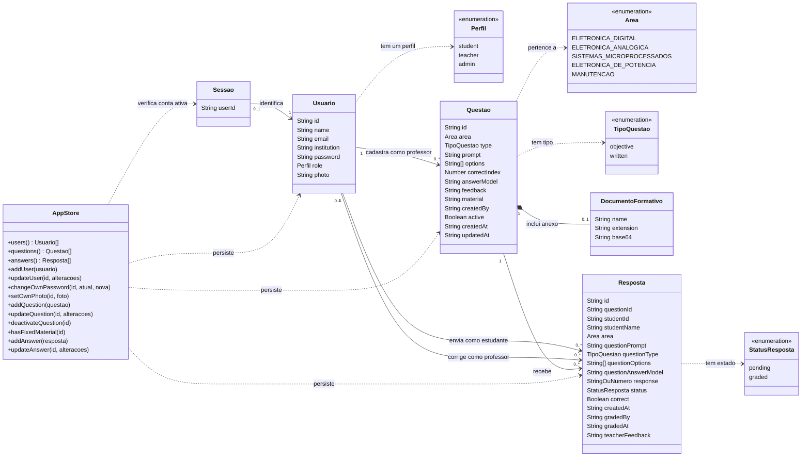

# Diagrama de classes do Conecta Elétron

O diagrama UML representa o modelo lógico do protótipo. Usuários, questões e respostas são objetos JavaScript persistidos no `localStorage`. As classes do diagrama descrevem esses objetos e suas relações.

## Regras representadas

- **Usuário e sessão.** Cada conta tem um perfil. A sessão local guarda o identificador da conta ativa e é usada em **Minha conta** para vincular a troca de senha ou foto ao próprio usuário. A foto é opcional.
- **Questão.** Toda questão pertence a uma área e identifica seu autor em `createdBy`. A objetiva tem quatro alternativas e gabarito. A dissertativa tem uma resposta-modelo. O enunciado, o tipo e os campos próprios do tipo são usados no envio e na correção.
- **Material formativo.** `material` guarda um link e `materialDocument` guarda o anexo opcional, representado pela composição com **DocumentoFormativo**. Os dois podem coexistir. Nas questões de demonstração, o **AppStore** mantém os links fixos pelo identificador da questão.
- **Resposta.** Cada envio referencia uma questão e a conta do estudante. O procedimento de envio impede uma segunda resposta do mesmo estudante à mesma questão. `response` guarda o índice numérico da alternativa ou o texto da dissertativa. Os campos copiados da questão preservam o contexto da resposta se o professor editar o enunciado, as alternativas ou a resposta-modelo.
- **Correção.** A objetiva recebe `graded` e `correct` no envio. A dissertativa começa com `pending` e `correct` nulo. A correção manual registra o professor, a data, o resultado e uma devolutiva opcional.
- **Desempenho.** Os painéis calculam os indicadores a partir das respostas. O aproveitamento considera acertos e erros já corrigidos.

## Arquivos de referência

- [Persistência e operações do AppStore](../js/storage.js)
- [Sessão, envio e correção na interface](../js/app.js)
- [Manual do sistema](MANUAL-DO-SISTEMA.md)
